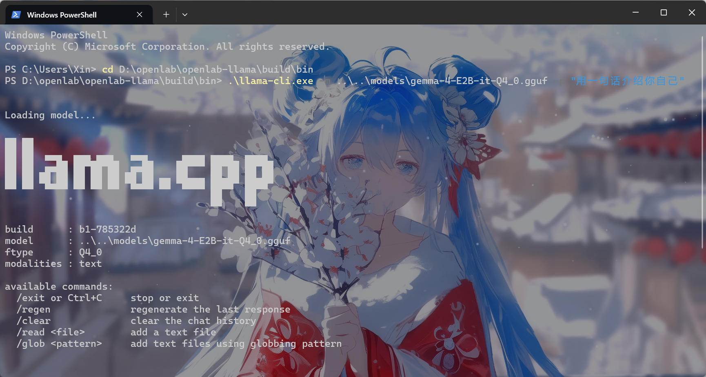
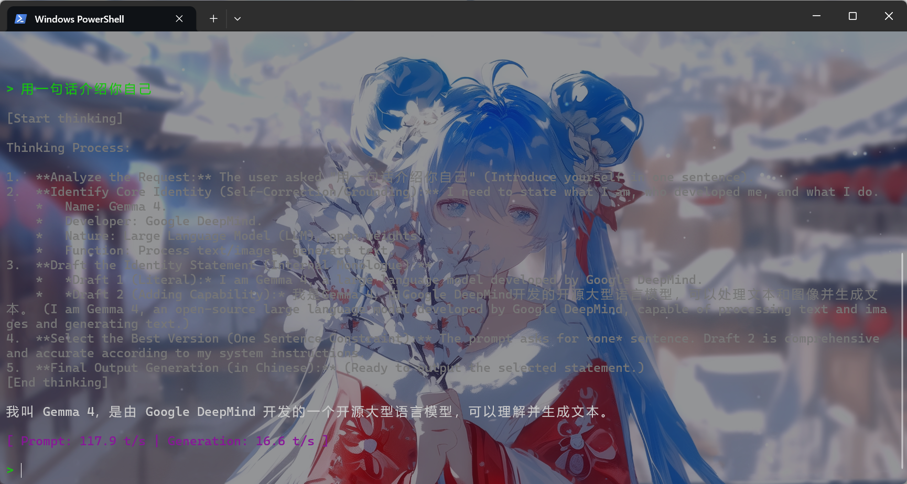
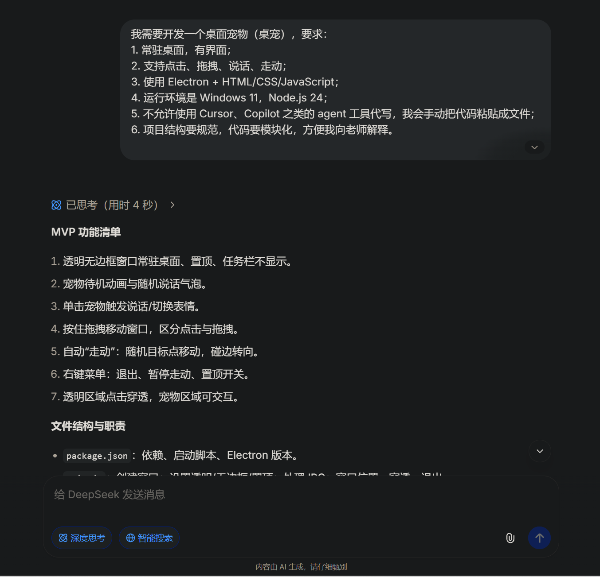
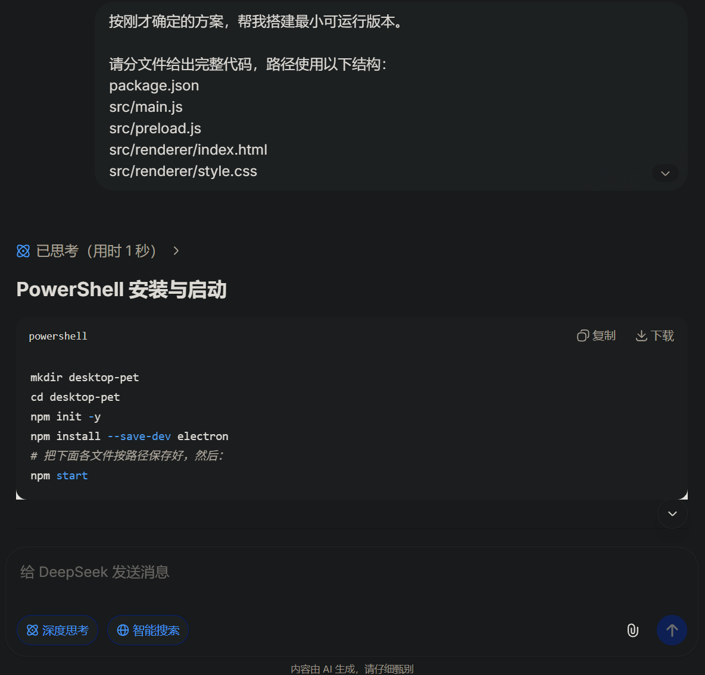
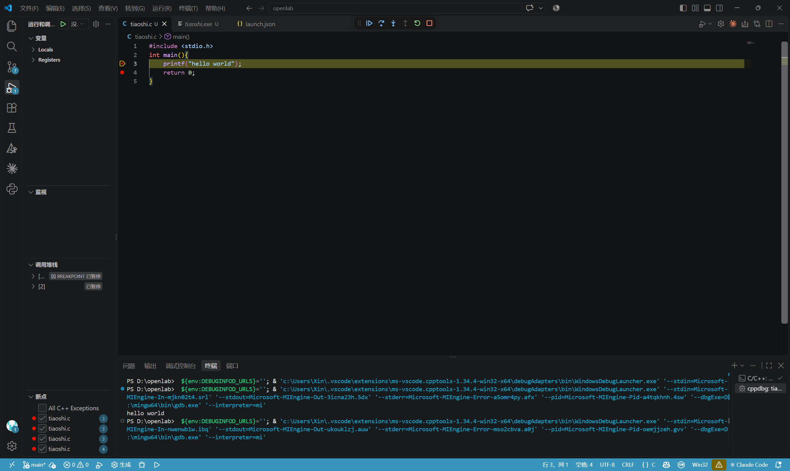
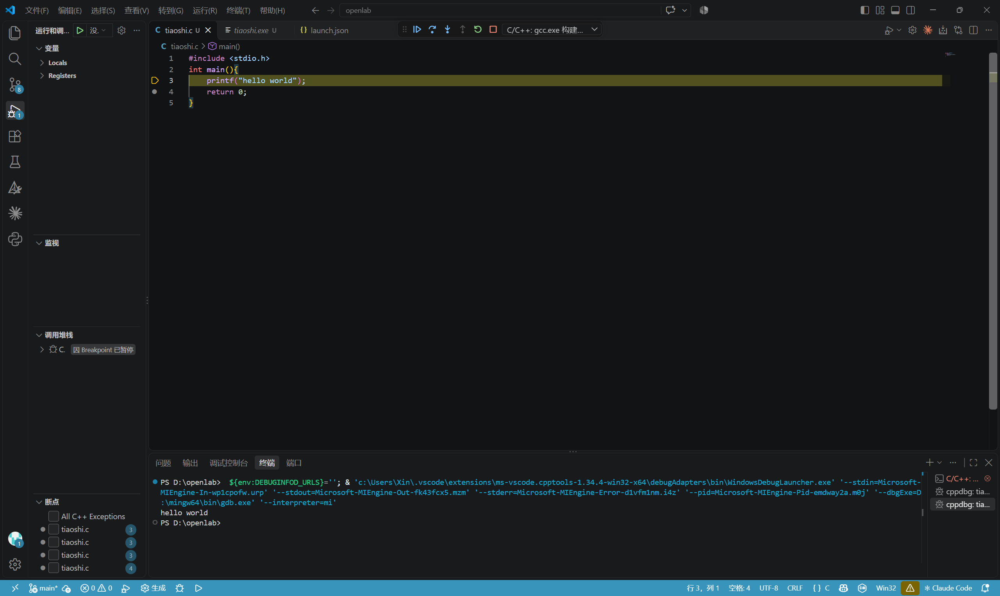
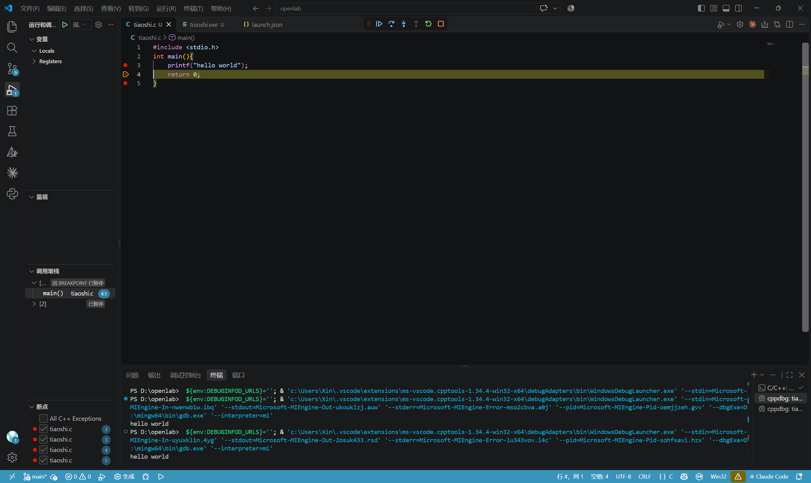
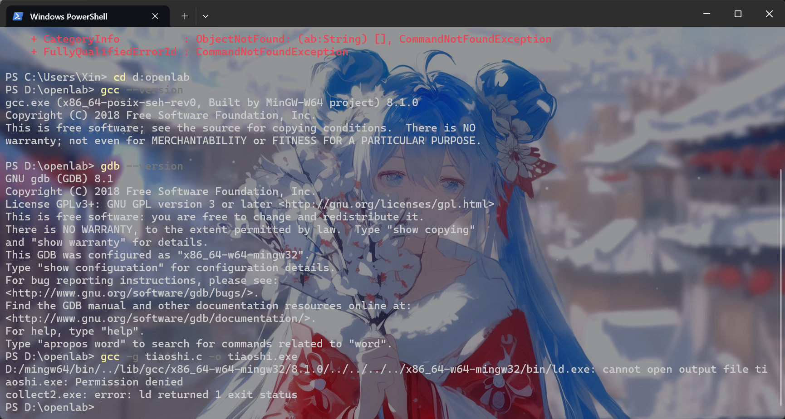
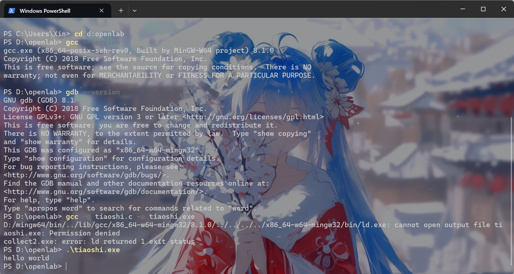

# OpenLab 2026 纳新笔试答卷

**姓名：**郭玉鑫  
**学号：**202600130132  
**答卷格式：**Markdown，图片使用相对路径。

## 第 1 题：让阅卷的人舒服一点

本答卷采用 Markdown 编写，使用标题、代码块、表格和相对路径图片组织答案。导出 PDF 时，请同时按提交要求附上 Markdown 源文件及图片。

## 第 2 题：Git 与 GitHub

本地使用 Git 管理各题材料，并建立了以下公开仓库：

| 仓库 | 对应内容 |
| --- | --- |
| [openlab-answers](https://github.com/2179801681-byte/openlab-answers) | 答卷与截图 |
| [openlab-llama](https://github.com/2179801681-byte/openlab-llama) | 第 3 题编译日志和运行记录 |
| [openlab-pet](https://github.com/2179801681-byte/openlab-pet) | 第 4 题桌宠源码和运行材料 |
| [openlab-env](https://github.com/2179801681-byte/openlab-env) | 第 6 题环境与 C 程序 |
| [openlab-brainfuck](https://github.com/2179801681-byte/openlab-brainfuck) | 第 7 题答案和程序 |

仓库使用 `.gitignore` 排除模型、依赖和构建产物；第 3 题保留了 `feature/q03-build` 开发分支及合并到 `main` 的记录。

**AI 使用说明：**电脑中原本已安装 Git。使用 AI 查询 Git 指令，并辅助完成仓库建立、提交与推送。

## 第 3 题：！？模型？！

### 编译和运行

从源码编译 `llama.cpp`，使用的源码提交为 `785322d`，编译器为 MSVC 19.51，采用 CPU 后端。完整 configure 和 build 日志位于 [build_log.txt](https://github.com/2179801681-byte/openlab-llama/blob/main/logs/build_log.txt)。

一次单轮对话使用的命令如下，工作目录为 `D:\openlab\openlab-llama\build\bin`：

```powershell
.\llama-cli.exe -m ..\..\models\gemma-4-E2B-it-Q4_0.gguf `
  -p "用一句话介绍你自己" -n 200 -t 8 -ngl 0 -st `
  --no-display-prompt --reasoning off
```

- 模型回答的第一句话：我是一个由 Google DeepMind 开发的大型语言模型，名为 Gemma 4。
- 本次记录的生成速度：`16.2 tokens/s`；提示词处理速度：`81.8 tokens/s`。
- 对应的 [CPU 运行记录](https://github.com/2179801681-byte/openlab-llama/blob/main/logs/run-cpu.txt)记录了上述结果；这是 AI 协助执行的一次测试，截图与该次参数不一定完全相同。





### 参数说明

- `-n`：限制最多生成的新 token 数量。
- `-t`：控制生成阶段使用的 CPU 线程数。改为 `1` 后仍可运行，速度可能下降，实际幅度取决于硬件和负载。
- `-ngl`：控制最多卸载到 GPU 的模型层数；`0` 表示不卸载。

本次编译没有启用 GPU 后端，设置 `-ngl 9999` 时程序提示 `no usable GPU found`，并忽略该选项。如果使用 GPU 后端，而指定层数及运行所需缓存超过可用显存，可能出现显存分配失败；是否自动调整取决于版本、参数和后端，应以实际日志为准。

### 编译日志选取

1. `-- The C compiler identification is MSVC 19.51.36256.0`：CMake 识别到使用的 C 编译器为 MSVC。
2. `-- Build files have been written to: D:/openlab/openlab-llama/build`：configure 完成，构建文件已生成。
3. `[1/423] Building CXX object ggml\src\CMakeFiles\ggml-cpu.dir\ggml-cpu\hbm.cpp.obj`：构建阶段开始编译 CPU 后端的一个 C++ 目标文件。

**AI 使用说明：**本题使用 AI 查询 PowerShell 中运行模型的方法；源码编译和模型运行过程中也接受了 AI 的操作协助。最终参数与输出需结合日志自行核对。

## 第 4 题：君子六艺——御

选择二档，使用 Electron、HTML、CSS 和 JavaScript 实现桌宠。项目包含透明无边框窗口、点击反馈、拖拽、随机走动、气泡，以及保存位置、朝向和点击次数的代码。

- 项目仓库：[openlab-pet](https://github.com/2179801681-byte/openlab-pet)
- 网页 AI 会话：[DeepSeek 对话分享](https://chat.deepseek.com/share/hh0oybwokwdimv6u1d)
- [运行录屏](../assets/q04/2026-11-02%2012-52-33.mp4)


### 两轮关键对话

1. 首先说明桌宠需要常驻、点击、拖拽、说话和走动，并限定 Windows、Electron 技术栈，要求 AI 先给功能清单和文件职责。这样问是为了先明确项目边界，避免一开始就生成难以理解的大段代码。
2. 接着要求按文件给出最小可运行版本，并明确透明无边框窗口、`contextIsolation` 和启动命令。这样问是为了先验证窗口能否运行，再逐步加入交互，便于定位问题。





### 三个关键模块

1. `src/main.js`：创建桌宠窗口并控制窗口移动；接收渲染进程的交互消息，将位置和状态交给存储模块。
2. `src/renderer/pet.js`：处理鼠标点击、拖拽判定、气泡和表情；从页面接收用户操作，通过预加载接口向主进程传递数据。
3. `src/state-store.js`：读取和保存窗口位置、方向和点击次数；数据来自主进程，写入应用的用户数据目录以供下次启动读取。

扩展任务选择持久化：代码中保存位置、朝向和点击次数。AI 在扩展过程中具体卡住的位置及解决过程，尚需结合实际对话补充。

**AI 使用说明：**Agent 协助梳理桌宠的大框架、整理和润色提示词，并为网页 AI 会话准备提问；项目代码通过对话式 AI 逐步讨论。

## 第 5 题：阅读理解

本题目前完成“1. 基础入门”，其余部分暂未完成。

1. 程序入口目录：`entry/src/main/ets/entryability`，入口文件通常为 `EntryAbility.ets`。
2. 页面入口目录：`entry/src/main/ets/pages`，首页通常为 `Index.ets`。
3. 在第二页通过 `UIContext` 获取路由并返回上一页：

```ts
let uiContext: UIContext = this.getUIContext();
let router = uiContext.getRouter();
router.back();
```

4. 第二页路由配置文件：`entry/src/main/resources/base/profile/main_pages.json`。

```json
{
  "src": ["pages/Index", "pages/Second"]
}
```

**AI 使用说明：**AI 用于理解题目和阅读文档时的指导。现有材料为阅读理解答案，尚未附 HarmonyOS 项目的编译或运行记录。

## 第 6 题：环境三选一

选择方向 A：VSCode 与 C 语言。使用已有 GCC、GDB 和 C/C++ 扩展，编写并运行 `Hello World`，在 VSCode 中设置断点调试，也在 PowerShell 中运行生成的程序。

源码：[tiaoshi.c](https://github.com/2179801681-byte/openlab-env/blob/main/src/tiaoshi.c)。

截图拍摄时，程序位于母文件夹 `D:\openlab`；整理资料后，源码和可执行文件移动至 `D:\openlab\openlab-env\src`。因此截图中的路径与当前路径不同。











**踩坑记录：**截图中 `gcc -g tiaoshi.c -o tiaoshi.exe` 曾提示无法打开输出文件，随后运行已有的 `tiaoshi.exe` 显示 `hello world`。该截图不足以证明本次重新编译成功；具体原因和处理过程待补充。

**AI 使用说明：**电脑中已有所需环境和软件；操作步骤和截图要求曾询问 AI，并根据实际运行情况核对。

## 第 7 题：奇怪的书

### 第一页

程序把输入字符的数值从第 0 个单元转移到第 1 个单元，再减 1 后输出。若输入数值为 `x`，输出值为 `(x - 1) mod 256`。

例如：输入 `B(66)`，输出 `A(65)`；输入 `A(65)`，输出 `@(64)`。输入 `NUL(0)` 时结果为 255，不属于标准 ASCII。

### 第二页

第一个单元置为 10，循环 10 次，使后两个单元各变为 80。第一个输出单元减 1 后得到 `O(79)`，第二个输出单元为 `P(80)`，因此输出：

```text
OP
```

### 第三页

```text
,>,[<+>-]<.
```

两个输入分别存入相邻单元；循环将第二个单元的值逐次加到第一个单元，最后输出第一个单元。例如 `A(65)` 和 `!(33)` 的和为 98，输出 `b`。和值大于 127 时不属于标准 ASCII，显示取决于环境。

**AI 使用说明：**由于我对这门语言不熟悉，本题主要由 AI 协助分析和编写代码，我对结果进行了审阅。实际运行记录待补充。

## 待补充材料

- 第 3 题：核对是否有同一次运行中完整命令、首句和速度同时可见的截图；如需申报 `llama-server` 加分，请补充实际调用截图或输出。
- 第 4 题：补充持久化扩展任务中 AI 卡住的具体步骤，以及实际解决方法；确认录屏和 DeepSeek 分享链接可被阅卷者访问。
- 第 5 题：ArkUI 开发与 API 参考部分尚未完成。
- 第 6 题：补充编译提示 `Permission denied` 的实际原因与处理过程，或补充一次成功编译并运行的截图。
- 第 7 题：如有实际运行或审阅记录，可补充；目前不将其写成已验证事实。
